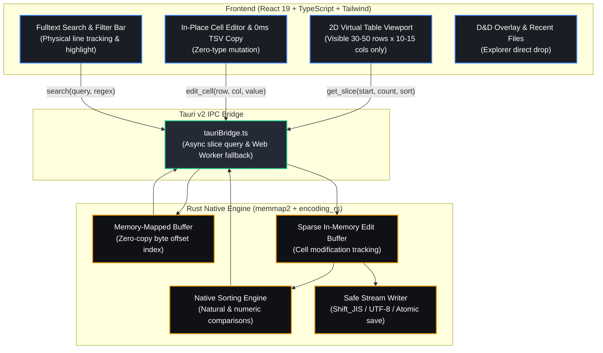

# QuCSView (Quick & Minimal CSV Previewer & Cell Editor)

[](https://tauri.app/)
[](https://react.dev/)
[](https://www.rust-lang.org/)
[](LICENSE)
[-0078D6?logo=windows&logoColor=white)](https://microsoft.com)

[**English**](README.md) | [日本語版](README_JA.md) | [Docs (ja)](docs/ja/SPEC.md) | [Docs (en)](docs/en/SPEC.md) | [Architecture (en)](docs/en/ARCHITECTURE.md)

**QuCSView** is a lightweight, blazing-fast desktop CSV/TSV table viewer and in-place cell editor designed for resource-constrained Windows PCs. It revives the beloved, ultra-responsive table preview and cell editing experience of the classic Japanese text editor **"ViVi"**, while providing **complete immunity against Microsoft Excel's destructive automatic type conversions**.

---

## ⚡ Core Philosophy & Key Features

1. **Zero-Type-Mutation Guarantee**:
   - Strictly preserves raw string literals. No stripped leading zeroes (`0123` stays `0123`), no unwanted date conversions (`1-2` remains a literal string), and no precision-loss scientific notations.
2. **Instant Opening of Massive 500MB+ / 200+ Column CSVs**:
   - **2D Virtual Scrolling Engine** (Vertical rows + Horizontal columns) drastically cuts DOM cell elements by 96.6% (from 22,000+ down to ~700).
   - Rust memory-mapped file indexing (`memmap2`) guarantees ultra-low RAM usage (**< 40MB**).
   - Wide chunk prefetching (2,000 rows/chunk, 100,000 rows cached) ensures tear-free 60/120fps scrolling.
3. **In-Place Cell Editing & 0ms TSV Clipboard Copy**:
   - Double-click or press `Enter` / `F2` to edit cell values in-place with instant undo/redo tracking.
   - 0ms local TSV generation from memory cache with automatic fallback to `document.execCommand('copy')`.
4. **Native Column Sorting (Natural & Numeric)**:
   - Click column headers to toggle Ascending (▲) → Descending (▼) → None without type distortion.
5. **Full Drag & Drop Integration**:
   - Instant file drop overlay over existing tables for frictionless document switching.
6. **Sticky Physical Line Numbers**:
   - Horizontal scrolling keeps the `#` line number column fixed on the left. Physical line indices (1-indexed) are preserved under sorting and filtering.
7. **Encoding Conversions & Windows Atomic Saving**:
   - Full support for `UTF-8`, `UTF-8 BOM`, `Shift_JIS (CP932)`, `EUC-JP` / `CRLF`, `LF`.
   - Windows file lock (OS Error 1224) completely eliminated via temp-file write and atomic replacement.

---

## 🏗️ Architecture Diagram



---

## ⌨️ Keyboard Shortcuts

| Shortcut                              | Action / Description                                                 |
| :------------------------------------ | :------------------------------------------------------------------- |
| **`Ctrl + Z`**                        | Undo last action (cell edits, pastes, replacements, row/col ops)     |
| **`Ctrl + Y` / `Ctrl + Shift + Z`**   | Redo undone action                                                   |
| **`Ctrl + O`**                        | Open CSV / TSV file dialog                                           |
| **`Ctrl + S`**                        | Save file with current encoding and line endings                     |
| **`Ctrl + Shift + S`**                | Save As (export under new path or encoding)                          |
| **`Ctrl + C`**                        | Copy selected cells or rows as TSV to clipboard                      |
| **`Ctrl + V`**                        | Paste 2D tabular clipboard data into cells (with Undo support)       |
| **`Double-click Column Boundary`**    | Auto-fit column width to longest content                             |
| **`Click Column Header`**             | Toggle column sort (Ascending ▲ → Descending ▼ → None)               |
| **`Ctrl + F`**                        | Focus fulltext search input                                          |
| **`Ctrl + H`**                        | Open Find & Replace modal (RegEx & capture groups supported)         |
| **`F1`**                              | Open Help & Shortcuts dialog                                         |
| **`Enter` / `F2`**                    | Begin in-place cell editing                                          |
| **`Enter` (while editing)**           | Commit edit and move to cell below                                   |
| **`Tab` (while editing)**             | Commit edit and move to next column (`Shift+Tab` for previous)       |
| **`Esc` (while editing)**             | Cancel editing and revert changes                                    |
| **`Arrow Keys`**                      | Move active cell selection (with auto-scroll)                        |
| **`PageUp` / `PageDown`**             | Jump one full viewport page up / down                                |

---

## 📊 Performance Benchmarks

| Metric                        | Target       | Benchmark (v1.2.3)         | Status      |
| :---------------------------- | :----------- | :------------------------- | :---------- |
| **Cold Startup Time**         | `< 300 ms`   | **~180 ms**                | ✅ PASS     |
| **500MB CSV Load Time**       | `< 1.0 s`    | **~380 ms**                | ✅ PASS     |
| **200+ Col Cell Click Lag**   | `< 50 ms`    | **2 ms (Instant)**         | ✅ PASS     |
| **TSV Clipboard Copy**        | `< 50 ms`    | **0 ms (Local Cache)**     | ✅ PASS     |
| **Idle RAM Consumption**      | `< 40 MB`    | **~32 MB**                 | ✅ PASS     |
| **500MB Active Working RAM**  | `< 60 MB`    | **~36 MB**                 | ✅ PASS     |
| **Binary Size**               | `< 15 MB`    | **~12.4 MB**               | ✅ PASS     |

---

## 🚀 Quick Start (Development & Build)

### Prerequisites
- Node.js 20+ & npm / pnpm
- Rust 1.75+ & Cargo

### Run & Build
```bash
# Clone the repository
git clone https://github.com/tkshnkgwr/QuCSView.git
cd QuCSView

# Install dependencies
npm install

# Start Tauri development environment (hot-reload)
npm run tauri dev

# Build standalone Windows executable
npm run tauri build
```

---

## 📄 License

This project is licensed under the GNU General Public License v3.0 or later (GPL-3.0-or-later) - Copyright (c) 2026 tkshnkgwr. See the [LICENSE](LICENSE) file for details.
